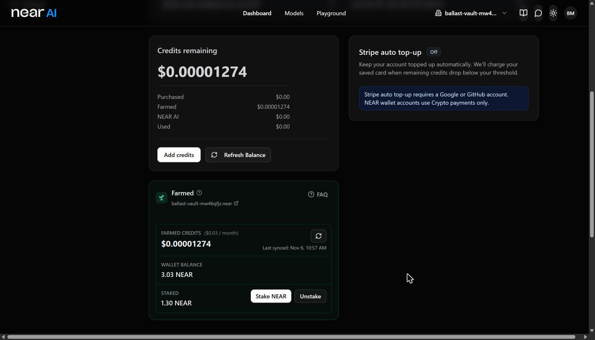

# Ballast

**Your NEAR pays for your AI, and never a token more than it needs to.**

NEAR AI lets you stake NEAR for inference: the staking rewards on that stake go to NEAR AI and come back as
non-transferable AI credits. Stake too much and you burn yield on credits you can't cash out. Stake too little and
your requests get throttled. Moving stake back out takes about 4 epochs, so nobody can tune this by hand.

Ballast is a non-custodial vault plus an agent. The vault holds your NEAR and splits it between NEAR AI's
stake-for-inference farm and an ordinary staking pool. The agent watches your usage, forecasts your burn, and moves
the split only when it drifts, inside limits you set on-chain. It can never send your NEAR anywhere else.

Built at **NEAR HACKATHON** for the **Agent Economy** track: an agent that earns (staking yield) and spends (AI
compute) on its owner's behalf, with every move bounded by an on-chain policy.

* **Website:** [near-autobalancer.vercel.app](https://near-autobalancer.vercel.app/), a harbour game you can play
  against the agent in 75 seconds.
* **Dashboard:** [near-autobalancer.vercel.app/app.html](https://near-autobalancer.vercel.app/app.html), a 100,000
  NEAR demo vault, the live testnet vault `vault.ballast-11012319.testnet`, or the mainnet vault
  `ballast-vault-mw46qfjz.near`.
* **Demo video:** [docs/ballast-demo.mp4](docs/ballast-demo.mp4) (2:16): the game, the dashboard and a live
  rebalance.
* **Status:** the full loop runs on NEAR **testnet**. On **mainnet**, a Ballast vault has staked into NEAR AI's
  real farm, NEAR AI Cloud shows its credits, and the owner has signed a policy change from the dashboard with a
  wallet ([Live on mainnet](#live-on-mainnet)).
* **Goal:** get this, or a feature like it, built into near.com, so anyone who stakes NEAR can point part of it at
  their AI usage ([Goal](#goal-built-into-nearcom)).

## For judges: do X, see Y

| Do | See |
|---|---|
| `cargo test` | 43 contract tests pass (40 vault, 3 pool) |
| `cd agent && npm install && npm test` | 15 policy, simulator and digest tests pass |
| `node src/simulate.ts` (in `agent/`) | The table below: Ballast 0 throttled hours, set-and-forget 116, all-in AI earns 0 NEAR |
| `node src/agent.ts status` (in `agent/`) | The live testnet vault's balances, farm position and the agent's next move, read over RPC with no keys |
| Open the [dashboard](https://near-autobalancer.vercel.app/app.html), press **Watch** (the testnet vault id is filled in) | The same vault's split, target and next step in the browser |
| On the same page, watch `ballast-vault-mw46qfjz.near` | The mainnet vault, read from mainnet RPC, with what NEAR AI's farm has paid it ("farm paid") |
| Open the [dashboard](https://near-autobalancer.vercel.app/app.html), press **Open the demo vault**, pick "ask me first" and press play | The month pauses on day 11 with "Move 19,378 NEAR toward NEAR AI" for you to approve |
| Open the [website](https://near-autobalancer.vercel.app/) and press **A** | The agent plays the month and the end card compares it with set-and-forget and all-in AI |

CI runs the first three rows on every pull request (`.github/workflows`).

## Try it in three commands

Needs Rust 1.86 (pinned in `rust-toolchain.toml`) and Node 22.18 or later. No NEAR account needed for these.

```bash
cargo test                                   # 43 contract unit tests (vault + pool)
cd agent && npm install && npm test          # 15 policy, simulator and digest tests
node src/simulate.ts                         # 30 days of usage, three strategies, in under a second
```

What you should see from the simulator (100,000 NEAR vault, $100/week budget, usage doubles from day 10 to 20):

```
strategy   unmet usage  throttled h  NEAR yield earned  unused credits  avg AI share  moves
ballast          $0.00            0    110.6 ($276.62)         $104.24         65.9%      8
static         $120.67          116    198.9 ($497.34)           $3.45         43.4%      0
all-ai           $0.00            0        0.0 ($0.00)         $439.84        100.0%      0
```

* **static** stakes exactly the stated budget once and leaves it: it earns the most yield but is throttled for 116
  hours when usage spikes.
* **all-ai** stakes everything for AI: never throttled, earns no NEAR, and ends with $440 of credits it can't cash out.
* **ballast** is never throttled and still earns 110 NEAR of ordinary yield.

`node src/simulate.ts --realtime 60` replays the Ballast run hour by hour over 60 seconds, showing each agent move.
Flags: `--vault 60000 --budget 100 --spike-day 3 --spike 2 --spike-end 0 --near-usd 5 --days 30`.

## How it works

```
 owner ──deposit / set_policy / exit / withdraw──▶  vault.<you>.near  ◀──rebalance / step── agent (function-call key)
                                                     │            │
                         stake(product_id) ◀─────────┘            └────────▶ deposit_and_stake
                         unstake / withdraw                                   unstake / withdraw
                  NEAR AI staking-contract (farm)                         ordinary staking pool
                  rewards → AI credits                                    rewards → NEAR
```

* **Vault contract** (`contracts/vault`, Rust, near-sdk 5.26). One per user, on a sub-account they own. Stores the
  owner, the policy (min and max AI share, buffer days, cooldown, minimum move, top-up cap, weekly AI budget), the
  AI target, and the two contract ids. The agent sets a target and steps toward it one action at a time
  (`StakeAi`, `UnstakeAi`, `WithdrawAi`, `StakeYield`, `UnstakeYield`, `WithdrawYield`, and the emergency
  `BuyCredits`). Every check only lets funds move *toward* the
  target, so a bad agent can stall the vault but not drain or redirect it. After each action the vault re-reads its
  balances from the two contracts' own views (`sync`). Every move emits a NEP-297 event (`standard: "ballast"`).
* **Agent key.** The agent signs with a function-call access key on the vault account, limited to `rebalance`,
  `step` and `sync`. Function-call keys cannot attach deposits or call other methods, and `withdraw` sends only to
  the owner and needs 1 yoctoNEAR attached. On testnet we tried all three attacks; see "Trust" below.
* **Emergency top-up.** `BuyCredits` buys one-off credit packs through the staking contract's `pay`. The vault
  allows it only up to `topup_cap` per rolling 30 days and only out of yield it has earned (yield-side value above
  the NEAR moved in), so a top-up never spends principal.
* **Upgrades.** `migrate` moves a v1 vault's state to v2 in the same transaction as the code deploy
  (`agent/scripts/upgrade-vault.ts`); the testnet vault was upgraded in place.
* **Exit.** The owner calls `exit`. From then on the agent can't set targets and *anyone* may call `step` to
  unwind both sides, so nobody can block an exit. The owner then calls `withdraw`.
* **AI side.** NEAR AI's own `staking-contract` from
  [nearai/house-of-stake-contracts](https://github.com/nearai/house-of-stake-contracts) (release build at commit
  `056fb6e`, sha256-checked by the deploy script), with a Farm product at NEAR AI's published rate:
  `$100 NEAR x 1 month = $1 credit`.
* **Yield side, and the pool behind the AI farm.** `contracts/pool`: a small staking pool with the standard
  interface (`deposit_and_stake`, `unstake`, `withdraw`, `get_account`), a fixed APY and a configurable unbond.
* **Agent** (`agent/src/agent.ts`, TypeScript on Node). Each tick: sync, read the farm position, pending unstakes
  and pool balance, read the credit meter, run the policy, buy emergency credits if needed, then `rebalance` and
  `step`. The weekly budget comes from the vault's policy (`budget_micro_usd_week`), so the owner sets it on-chain.
  Each tick is logged to `agent/state/<vault>.log.jsonl`; `node src/agent.ts digest` turns it into the weekly
  digest ("Covered $X of $Y in usage; earned Z NEAR; moved N NEAR toward AI on Tuesday: ...").

### The policy (`agent/src/policy.ts`)

Credits per staked NEAR are a published constant: the farm's `reward_rate` (24-decimal reward units per second per
NEAR). At NEAR AI's rate that is **c = $0.000329 per NEAR per day**, whatever the NEAR price.

1. Forecast burn **b** ($/day): an exponentially weighted average of rolling 24-hour usage, never below
   the user's stated weekly budget, or 75% of the latest day.
2. Steady-state AI stake: **b / c**.
3. Buffer **B = buffer days × b** (default 3). If credits are below B, add stake to refill the gap over 7 days.
   If credits are above 2B, return the excess to yield (trims are slow to undo, so they need a full double buffer).
4. Clamp to the owner's min and max AI share. Report coverage honestly when the vault is too small.
5. Emergency: if runway is shorter than the time it takes to add stake (unbond + 1 day), buy just enough one-off
   packs to bridge that gap, within what the vault allows, as well as adding stake.
6. Don't churn: move only when the change exceeds 10% of the vault and the vault's `min_move`, except in an
   emergency.
7. Re-run every epoch.

The simulator picked the defaults: a 7-day buffer avoided throttling too, but parked about 10 points more of the
vault in credits (`node agent/scripts/sweep.ts` reruns the sweep).

## Live on mainnet

The concept's day-1 risk was whether a contract account can stake into NEAR AI's farm at all. It can, on mainnet:

* The vault `ballast-vault-mw46qfjz.near`, on its own `.near` account, registered with NEAR AI's staking contract
  `stake.dao`. It then staked 1.3 NEAR into the "NEAR AI Cloud Credits" farm (product `prod_33Kp14MGUJa2QA`,
  validator `nearai.pool.near`, price "100 $NEAR x 1 month = $1 credit"). It used the normal `rebalance` + `StakeAi`
  path ([tx](https://nearblocks.io/txns/CvY15vdJzaUwohMXTiF4XL25b1aqsUTuNaXv2AsW9mkM)).
* `get_farm_position` on `stake.dao` shows the 1.3 NEAR, with reward units accruing.
* Mainnet's farm `reward_rate` is `7605141075366948`, about **$0.000657 per NEAR per day**, twice the testnet
  config. The agent takes the rate from the deployment file (`farmRewardRate`), so on mainnet a vault needs about
  half the stake for the same budget.
* Ids are in `agent/deployments/mainnet.json`. The script is `agent/scripts/mainnet-proof.ts` (`setup`, `status`).

NEAR AI Cloud credits the vault directly. The vault account signed in to cloud.near.ai with a NEAR wallet and was
bound as its organization's staking wallet. Cloud now lists the 1.3 NEAR stake as **Farmed** credits under
"Credits remaining": $0.0000127 so far, at $0.03 a month.



Binding is permanent: each organization has one funding wallet, and an organization with a bound wallet can't be
deleted. To sign in and bind, the vault account needs a full-access key, which the owner holds. The agent's key
stays limited to `rebalance`, `step` and `sync`.

## Live on testnet

The full stack is deployed under `ballast-11012319.testnet` (ids in `agent/deployments/testnet.json`):

| Account | What it is |
|---|---|
| `stake.ballast-11012319.testnet` | NEAR AI staking-contract, Farm product `prod_6TSXAT9FNIPqAs` |
| `pool-ai.ballast-11012319.testnet` | validator behind the farm (no APY: NEAR AI keeps the rewards) |
| `pool-yield.ballast-11012319.testnet` | yield pool, 1-epoch unbond. APY raised from 4.5% to 50% on 2 Nov so the small demo vault earns enough yield to pay for a top-up |
| `vault.ballast-11012319.testnet` | demo vault, ~12 NEAR, agent key limited to rebalance / step / sync |
| `vault-exit.ballast-11012319.testnet` | second vault used to test a full exit |

Look at it without any keys:

```bash
cd agent
node src/agent.ts status        # reads the vault, the farm and the pool, prints the plan, sends nothing
```

Deploy your own copy (needs a funded testnet account; the deploy script sweeps any `ballast-fund*` faucet accounts
in your credentials folder into the root):

```bash
./scripts/build.sh
cd agent
BALLAST_ROOT=<you>.testnet node scripts/deploy-testnet.ts   # keys read from ~/.near-credentials-ballast/<account>.json
node src/agent.ts once                                       # one agent tick: sync, plan, rebalance, step
node src/agent.ts usage 0.01                                 # record a usage spike on the testnet credit meter
node src/agent.ts loop 600                                   # run the agent every 10 minutes
node src/agent.ts digest 7                                   # what the agent did this week, in plain words
node scripts/upgrade-vault.ts                                # upgrade a v1 vault to v2 and set up top-ups
node scripts/trust-demo.ts                                   # the three attacks below
node scripts/exit-demo.ts setup|exit|finish                  # full exit on a second vault
```

Testnet amounts are small, so the default testnet budget is `BUDGET_USD_WEEK=0.015`, which a 12 NEAR vault can
cover. Credits only exist on mainnet, so on testnet `agent/src/meter.ts` applies NEAR AI's formula: credits earned
are the farm's on-chain `total_earned_reward_units` × $1 per unit, and credits spent are the usage it records.

### What has been run on testnet

* **Vault on a contract sub-account stakes into NEAR AI's farm** (the concept's day-1 risk, testnet side):
  rebalance + `StakeAi` 7 NEAR, then `StakeYield` 4.5 NEAR; the farm position accrues reward units.
* **Agent moves yield to AI across an epoch**: forecast burn needed 9.3 NEAR on the AI side, so the agent set the
  target and sent `UnstakeYield` 1.843 NEAR. After the epoch it sent `WithdrawYield` 1.843 and `StakeAi` 1.707,
  taking the AI side from 7 to 8.707 NEAR; the remaining 0.6 NEAR gap is inside the churn band.
* **Trust**:
  * agent key calls `withdraw` → rejected by the protocol (`MethodNameMismatch`);
  * agent key sets the AI target to 99% → rejected by the vault (`outside the policy band 0..9000bps`);
  * a stranger calls `step` → rejected by the vault (`agent or owner only`).
* **Usage spike** (the demo moment): with the vault upgraded to v2 in place, we recorded a $0.01 spike on the
  meter (about 5 days of the testnet budget at once). Runway dropped to zero, the agent flagged an emergency, and
  it raised the AI target from 9.3 to 10.1 NEAR (90% of the vault, the policy cap) and started unstaking the
  yield side to fund it. The digest reports it as "Moved 0.801 NEAR toward AI (AI target 9.314 → 10.115) on
  Monday 2 Nov: runway 0.0d is shorter than the 2.0d it takes to add stake."
  After the epoch the agent finished the move: `WithdrawYield` 0.932 NEAR
  ([tx](https://testnet.nearblocks.io/txns/G4gf8KkVrL4ox6Y92wvym4gyurES1b9TTWu3LnPeezEt)), then `StakeAi` 1.339 NEAR
  ([tx](https://testnet.nearblocks.io/txns/EoSJuF7goWvcyidzQyeZqMFCXs3B7GDVHxbKAdLm4nCB)). The AI side went from
  8.707 to 10.045 NEAR against the 10.115 target; the gap left is under the 0.5 NEAR dust threshold.
* **Emergency top-up**: in a later emergency, once the vault's earned-yield allowance was above the pack price, the
  agent sent `BuyCredits` for 1 pack at 0.001 NEAR
  ([tx](https://testnet.nearblocks.io/txns/8mFHgGMQyLHurwUoScuvuGoJLRmDUQtX5Un9kTnxFDC6)). NEAR AI's staking
  contract records it as purchase `pay_yDKU2Hz75Ldfy2vKg` on price `price_40isIJHJPGFpOJLkn4QbxgGB`. It was paid
  from yield the vault had earned, not from principal.
* **Full exit** on `vault-exit`: the owner called `exit`; a stranger account unstaked both sides; after the epoch
  the stranger withdrew 1.5 NEAR from NEAR AI's staking contract (`withdraw(validator_id)`) and 0.5 NEAR from the
  yield pool; the owner then withdrew 2.304 NEAR to their own account.

## Limits, said plainly

* Mainnet so far is one vault staking into NEAR AI's real farm, with its credits showing in NEAR AI Cloud. The
  full agent loop has run on testnet only.
* NEAR AI Cloud credits a contract-account vault directly once the vault is bound to an organization. The vault
  needs a full-access key to sign in and bind, and the binding is permanent.
* The yield side is our test pool, not a live validator or liquid staking token. Swapping a LiNEAR position for
  instant top-ups is a stretch goal.
* Top-ups are paid only from yield earned since v2 tracking began, so a small vault can only afford one once its
  yield builds up. On testnet, packs are a 0.001 NEAR one-off price on the farm product and the meter credits them
  at the NEAR price; on mainnet NEAR AI sells credits itself.
* The agent signs as the vault, so each call's prepaid gas (about 0.45 NEAR for a 450 Tgas staking call, held
  at a pessimistic price and mostly refunded) is out of the vault's balance while the call runs. The vault counts
  that held gas as liquid in its own checks (`liquid_in_call`, capped at half the 1 NEAR reserve); before 0.2.1
  this made full-balance stakes and 90% targets fail on testnet.
* The agent's function-call key has a 1 NEAR gas allowance; the owner re-adds the key when it runs out.

## Use it in the browser

`web/` is plain HTML and JavaScript with no build step (`node web/serve.mjs`, then open http://127.0.0.1:5310/). It
is deployed on Vercel at [near-autobalancer.vercel.app](https://near-autobalancer.vercel.app/). See
[`web/README.md`](web/README.md).

* **Keep the light on** (`index.html`): a month of NEAR AI usage in 75 seconds. Crates by the lighthouse are staked
  for NEAR AI, crates on the barge earn yield, and ships are AI requests. Drag crates across, or press A to let the
  agent play, and compare your month with the agent's.
* **Dashboard** (`app.html`): weekly AI budget, autopilot or "ask me first", guard rails, the stake split against
  the target, a credit forecast, and the rebalance history. The demo vault runs the agent's own policy code in the
  browser (`web/lib` is generated from `agent/src`). A testnet vault is read straight from the chain.
* **Wallet sign-in:** connect MyNearWallet, Meteor or HERE through NEAR Wallet Selector, or HOT Wallet's browser
  extension on mainnet. The vault's owner can then approve the next move (`step`), save the budget and guard rails
  on-chain (`set_policy`), deposit, exit and withdraw, each signed in the wallet. On mainnet the owner signed in with
  HOT and saved a weekly budget from the dashboard
  ([`set_policy` tx](https://nearblocks.io/txns/EfSW9AK2dyd4vY8C38xWEQRrFQugTf3EPFFmsQb1Nv1c)).

## NEAR tools used

| Tool | Where |
|---|---|
| NEAR AI stake-for-inference, `staking-contract` from [nearai/house-of-stake-contracts](https://github.com/nearai/house-of-stake-contracts) | The AI side of every vault: `stake(product_id)`, `unstake`, `withdraw(validator_id)`, `pay` for one-off credit packs |
| [near-sdk-rs](https://github.com/near/near-sdk-rs) 5.26 | The vault and pool contracts, cross-contract calls and callbacks, NEP-297 events, state migration |
| Function-call access keys | The agent's key can call only `rebalance`, `step` and `sync`, and can't attach deposits |
| Staking pool interface | `deposit_and_stake`, `unstake`, `withdraw`, `get_account` on the yield side |
| [near-api-js](https://github.com/near/near-api-js) 5.1.1 | The agent, deploy and demo scripts |
| [NEAR Wallet Selector](https://github.com/near/wallet-selector) 10.1.4 | Dashboard sign-in (MyNearWallet, Meteor, HERE) |
| NEAR RPC | Read-only `get_state` views from the dashboard and `agent.ts status` |

## Built during the hackathon

Everything in this repository was written from 1 November 2026, during the hackathon, with AI assistance. There is no earlier version of Ballast on NEAR or any other chain. These parts predate the hackathon and are
used as they are:

* NEAR AI's `staking-contract` (MIT/Apache-2.0), deployed unmodified on testnet from release commit `056fb6e`.
* The pixel renderer in `web/engine.js`, from [Pixel Plays](https://github.com/amirmushichge/pixel-plays) by Amir
  Mushich (MIT, see `web/THIRD_PARTY.md`). The harbour scene, game and dashboard are new.
* Libraries: near-sdk-rs, near-api-js, NEAR Wallet Selector.

## Status

Everything planned for the hackathon has run:

| Done | Where |
|---|---|
| Vault contract v2, upgraded in place from v1 | testnet |
| A vault on a contract account staked 1.3 NEAR into NEAR AI's real farm (`stake.dao`), and NEAR AI Cloud shows it as farmed credits | mainnet |
| Owner signed a `set_policy` from the dashboard with HOT Wallet | mainnet |
| Agent loop: forecast, rebalance across epochs, emergency path, on-chain budget, weekly digest | testnet |
| Trust checks, and a full exit by a stranger account | testnet |
| Emergency `BuyCredits` top-up, paid from earned yield | testnet |
| Simulator, CI, website, dashboard on Vercel, demo video | |

## Goal: built into near.com

Ballast is a separate vault today. The goal is for this, or a feature like it, to live where people already stake:
near.com. Staking there would ask one more question, "How much do you spend on AI each week?", and keep just
enough of the stake on NEAR AI's farm to cover it, with the rest earning ordinary yield.

What that would take:

* **A staking option, not a new app.** The vault already uses the standard staking-pool interface on the yield
  side and NEAR AI's own `staking-contract` on the AI side, so near.com could offer it next to its existing pools.
* **Credits on the user's own NEAR AI account.** NEAR AI Cloud already credits a bound contract account (see
  [Live on mainnet](#live-on-mainnet)). Built in, the binding would happen at sign-up, not by hand.
* **Liquid staking for the yield side**, such as LiNEAR, so a usage spike can be covered without waiting 4 epochs.
* **The same limits:** the agent can only move stake between the two sides, inside a band the user sets, and the
  user can always exit.

## Repository

```
contracts/vault    vault contract + unit tests
contracts/pool     testnet staking pool + unit tests
agent/src          policy, simulator, live agent, testnet credit meter, NEAR helpers
agent/scripts      deploy, upgrade, mainnet proof, trust demo, exit demo, parameter sweep
agent/deployments  testnet and mainnet account ids
web/               website, game and dashboard (static, deployed on Vercel)
docs/              screenshots and the demo video
.github/workflows  CI: contract tests, wasm build, agent tests, simulator
```

License: MIT (`LICENSE`).
